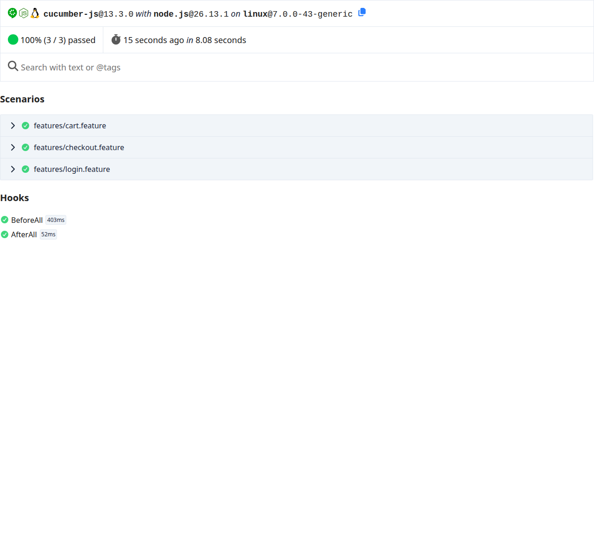
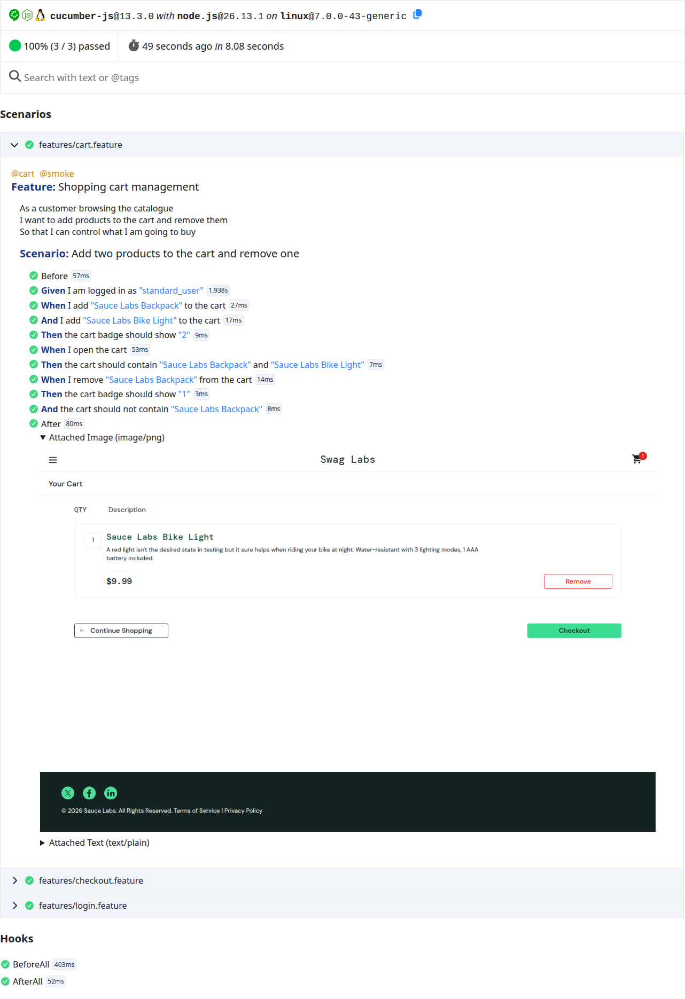
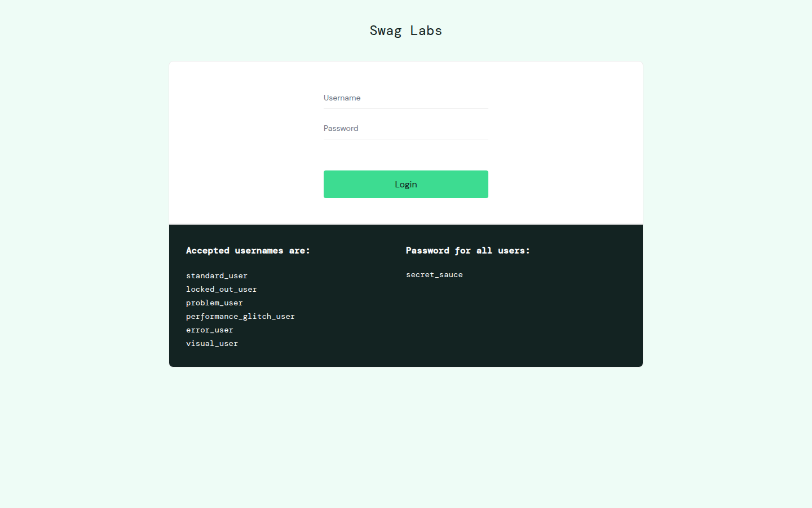
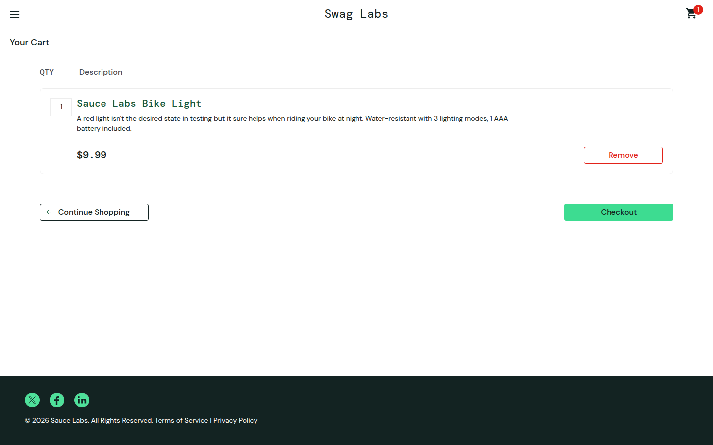
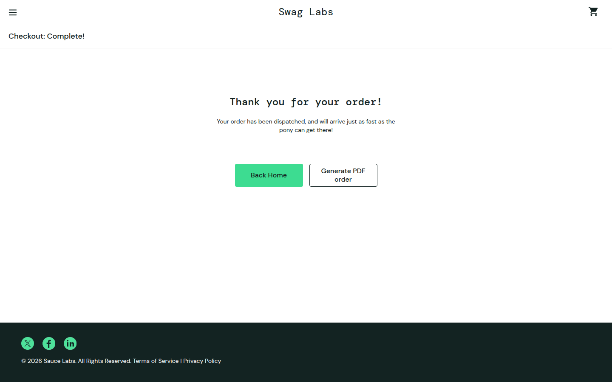

# Cucumber + Puppeteer UI-testide aruanne — Sauce Demo

| Väli | Väärtus |
|---|---|
| Projekt | `cucumber-puppeteer-saucedemo` |
| Testitav süsteem | Sauce Demo / Swag Labs — <https://www.saucedemo.com/> |
| Testiraamistik | Cucumber 13.3.0 (Gherkin, BDD) |
| Brauseriautomaatika | Puppeteer 25.17.0 + Chrome 157.0.8103.50 (headless) |
| Testikomplekt | 3 stsenaariumi, 27 Gherkini sammu (33 Cucumberi sammu koos hookidega) |
| Tulemus | **3/3 passed**, 0 failed, 0 skipped |
| Kestus | 8,08 s (testikoodi täitmine 7,91 s) |
| Käivituse aeg | 13.11.2026 kell 11:00 (Europe/Tallinn) |
| Keskkond | Ubuntu 26.04.1 LTS, Node.js 26.13.1, npm 11.20.0 |
| Aruande versioon | 1.0 |
| Keel | Eesti (aruanne), inglise (Gherkini stsenaariumid) |

---

## 1. Kokkuvõte

Lõin Sauce Demo veebipoe jaoks kolm iseseisvat UI-testi, kasutades Cucumberit
(Gherkin/BDD) ja Puppeteerit. Testid katavad kolme erinevat kasutajateekonda:

1. **T1 — autentimine:** sisselogimine kehtiva kasutajaga, tootekataloogi
   kontroll ja väljalogimine.
2. **T2 — ostukorvi haldamine:** kahe toote lisamine, ostukorvi loenduri ja
   sisu kontroll, ühe toote eemaldamine.
3. **T3 — tellimuse vormistamine:** tühja vormi valideerimine, kliendiandmete
   sisestamine, tellimuse ülevaade, kogusumma ja lõplik kinnitus.

Kõik kolm stsenaariumi läbisid esimesest käivitusest alates. Lõplik käivitus:
**3/3 stsenaariumi, 33/33 Cucumberi sammu, 0 viga, 8,08 sekundit.** Testikomplekt
läbis korduvkäivitustel 14/14 korda (sh üks kahe tööga paralleelne käivitus).

Testitud voogudes funktsionaalseid vigu ei leitud. Eraldi uurimiskäivitusel avastasin
ühe madala tõsidusega valideerimispuuduse: checkout-vormi eesnime väljale sobib
ainult tühikutest koosnev väärtus. See ei kuulu kolme automaatse stsenaariumi
hulka ja on dokumenteeritud peatükis 7.

---

## 2. Testitav projekt ja valiku põhjendus

### 2.1 Testitav süsteem

**Sauce Demo** (brändinimi *Swag Labs*) on Sauce Labs'i avalik demo-e-pood, mis on
loodud automatiseeritud testimise õppimiseks ja praktiseerimiseks. Tegemist on
Reacti ühelehelise rakendusega (SPA), kus on:

- sisselogimisleht demo-kontodega (`standard_user`, `locked_out_user`,
  `problem_user`, `performance_glitch_user`, `error_user`, `visual_user`);
- tootekataloog kuue tootega, sorteerimine ja ostukorvi lisamine;
- ostukorv koguste, hindade ja eemaldamisnuppudega;
- kolmeastmeline checkout: kliendiandmed → tellimuse ülevaade → kinnitus;
- simuleeritud maksmine (SauceCard #31337), seega päris makset ei toimu.

Rakenduse DOM sisaldab automatiseerimiseks mõeldud `data-test` atribuute
(`[data-test="username"]`, `[data-test="add-to-cart-sauce-labs-backpack"]`,
`[data-test="shopping-cart-badge"]`, `[data-test="complete-header"]` jne).
Testikontod ja parool on avalikult sisselogimislehel välja toodud.

### 2.2 Miks valisin selle projekti

1. **Avalik ja stabiilne.** Rakendus on kättesaadav ilma registreerimise ja
   testandmete ettevalmistamiseta; kataloog ja hinnad on fikseeritud.
2. **Kolm erinevat, äriliselt olulist funktsionaalsust.** Autentimine, ostukorvi
   olek ja mitmeastmeline vorm annavad võimaluse testida eri tüüpi
   kasutajainteraktsioone, mitte ainult ühte lehte.
3. **Päris UI-käitumine.** Reacti olekuhaldus, kliendipoolne marsruutimine,
   vormivalideerimine, dünaamiline ostukorvi loendur ja lehtedevaheline
   navigeerimine tekitavad realistlikke automatiseerimisprobleeme (ootamised,
   hüdratsioon, animatsioonid).
4. **Ohutu testikeskkond.** Makse on simuleeritud ega mõjuta päris tellimusi.
5. **Hea selektorite kvaliteet.** `data-test` atribuudid on CSS-klassidest ja
   tekstist oluliselt püsivamad.

### 2.3 Skoop

| Kaetud | Välja jäetud |
|---|---|
| Sisselogimine `standard_user` kontoga | Registreerimine (rakenduses puudub) |
| Väljalogimine ja sessiooni lõpetamine | Muud demo-kontod (`locked_out_user`, `problem_user` jt) |
| Toote lisamine ostukorvi | Toote sorteerimine ja filtreerimine |
| Ostukorvi loendur, sisu ja eemaldamine | Koguse muutmine (Sauce Demos puudub) |
| Checkout-vormi kohustuslike väljade valideerimine | Päris makse (simuleeritud) |
| Tellimuse ülevaade ja kogusumma | Responsiivsus ja mobiilivaade |
| Tellimuse kinnitamine | Ligipääsetavus (a11y), visuaalne regressioon |
| — | "Dynamic Catalog" ja "Generate PDF order" (uued funktsioonid) |

---

## 3. Testikeskkond ja paigaldus

### 3.1 Tööriistad

| Tööriist | Versioon | Roll |
|---|---|---|
| Node.js | 26.13.1 | Testide käituskeskkond |
| npm | 11.20.0 | Sõltuvuste haldus |
| @cucumber/cucumber | 13.3.0 | Gherkini parsija, stsenaariumide käivitaja, aruandlus |
| puppeteer | 25.17.0 | Chrome'i juhtimine DevTools Protocoli kaudu |
| Chrome for Testing | 157.0.8103.50 | Testbrauser (Puppeteeri hallatav, headless) |
| Ubuntu | 26.04.1 LTS | Operatsioonisüsteem |

Paigaldusjuhendid: [Cucumberi 10-minuti tutorial](https://cucumber.io/docs/guides/10-minute-tutorial/)
ja [Puppeteeri dokumentatsioon](https://pptr.dev/).

### 3.2 Paigaldus

```bash
npm ci
npx puppeteer browsers install chrome
```

Puppeteer paigaldab Chrome'i projekti lokaalsesse cache'i, mille määrab
`.puppeteerrc.cjs` (`cacheDirectory: .cache/puppeteer`). See hoiab brauseri
projektikaustas ega kirjuta kasutaja kodukataloogi.

**Tähelepanek:** selles keskkonnas ei käivitanud npm 11 Puppeteeri
`postinstall`-skripti (npm-i `allowScripts` poliitika), mistõttu Chrome jäi
esialgu alla tõmbamata. Lahendus oli käivitada `npx puppeteer browsers install chrome`
eraldi. See on dokumenteeritud ka README-s.

### 3.3 Projektistruktuur

```text
cucumber-puppeteer-saucedemo/
├── cucumber.js                    # Cucumberi profiil, formaadid, paralleelsus
├── .puppeteerrc.cjs               # Chrome'i cache asukoht
├── package.json
├── features/
│   ├── login.feature              # T1
│   ├── cart.feature               # T2
│   ├── checkout.feature           # T3
│   ├── step_definitions/
│   │   ├── common.steps.js        # ühised sammud (login, cart, kataloog)
│   │   ├── login.steps.js
│   │   ├── cart.steps.js
│   │   └── checkout.steps.js
│   └── support/
│       ├── world.js               # SauceWorld + Page Objectite hankimine
│       └── hooks.js               # brauseri elutsükkel, screenshotid
├── src/
│   ├── config.js
│   ├── data/products.js
│   ├── pages/
│   │   ├── BasePage.js
│   │   ├── LoginPage.js
│   │   ├── InventoryPage.js
│   │   ├── CartPage.js
│   │   └── CheckoutPage.js
│   └── support/browser.js
├── reports/                       # HTML, JSON, JUnit
├── artifacts/screenshots/
└── docs/
```

### 3.4 Käivitamine

```bash
npm test                 # kõik stsenaariumid
npm run test:smoke       # @smoke (login + cart)
npm run test:parallel    # kaks Cucumberi tööd
HEADLESS=false npm test  # nähtav brauser
```

---

## 4. Testide arhitektuur

### 4.1 BDD-voog

Iga test algab Gherkini stsenaariumist, mis on kirjutatud ärikeeles ja loetav ka
ilma koodita. Cucumber seob iga sammu (`Given` / `When` / `Then`) JavaScripti
funktsiooniga, mis kutsub Page Objecti meetodit; Page Object teeb Puppeteeri
kutsed ja sisaldab selektoreid.

```text
.feature (Gherkin)
    ↓ Cucumber
step definitions (tegevus + assert)
    ↓
Page Objects (selektorid + ootamised)
    ↓
Puppeteer / Chrome
```

### 4.2 Page Object muster

| Klass | Vastutus |
|---|---|
| `BasePage` | `goto`, `waitFor`, `click`, `fill`, `text`, `texts`, `isVisible`, `currentPath` |
| `LoginPage` | Sisselogimisvorm, hüdratsiooni ootamine, veateate lugemine |
| `InventoryPage` | Tootekataloog, ostukorvi lisamine, badge, külgmenüü ja väljalogimine |
| `CartPage` | Ostukorvi sisu, toote eemaldamine, checkout'i avamine |
| `CheckoutPage` | Kliendiandmete vorm, valideerimisviga, ülevaade, kogusumma, kinnitus |

Selektorid on iga Page Objecti `selectors` objektis. Tootenimede ja
`data-test` ID-de vastendus on eraldi failis `src/data/products.js`, et vältida
selektorite hajumist mööda testikoodi.

### 4.3 World, hookid ja isolatsioon

- **`BeforeAll`** käivitab ühe Puppeteeri brauseri ja loob screenshotikausta.
- **`Before`** loob iga stsenaariumi jaoks värske brauserikonteksti ja lehe.
  Küpsised ja `localStorage` ei kandu testide vahel üle.
- **`After`** teeb lõppseisundist screenshoti, salvestab selle failina,
  manustab pildi Cucumberi HTML-aruandesse ja sulgeb konteksti.
- **`AfterAll`** sulgeb brauseri ja koristab ajutise profiilikausta.

Iga stsenaarium saab `SauceWorld`-i kaudu vajalikud Page Objectid (`loginPage`,
`inventoryPage`, `cartPage`, `checkoutPage`), mis luuakse laisalt alles siis,
kui neid kasutatakse.

### 4.4 Aruandlus ja tõendid

Cucumber loob iga käivituse järel kolm aruannet:

| Fail | Otstarve |
|---|---|
| `reports/cucumber-report.html` | Iseseisev HTML-aruanne, manustatud screenshotidega |
| `reports/cucumber-report.json` | Masinloetav tulemus |
| `reports/cucumber-report.xml` | JUnit-vorming CI-tööriistadele |

Lisaks salvestatakse iga stsenaariumi lõppseisund `artifacts/screenshots/` kausta.

### 4.5 Testide kvaliteet

- **Stabiilsed selektorid:** eelistatud on `data-test` atribuudid, mitte
  CSS-klassid ega tootekirjeldused.
- **Selgesõnalised ootamised:** `waitForSelector`, `waitForFunction` ja
  olekupõhised kontrollid. Fikseeritud une kasutatakse ainult Reacti
  hüdratsiooni akna katmiseks (`HYDRATION_DELAY`).
- **Iseseisvad testid:** iga stsenaarium loob oma sessiooni ja ostukorvi.
- **Selged assertid:** `node:assert/strict` koos teatega, mis näitab puuduva
  või vale väärtuse.
- **Tõendid:** iga stsenaariumi screenshot nii failina kui aruandes.

---

## 5. Teststsenaariumid

### 5.1 Ülevaade

| ID | Feature | Stsenaarium | Eesmärk | Sammud | Tulemus |
|---|---|---|---|---|---|
| T1 | [login.feature](../features/login.feature) | Successful login and logout with a standard user | Kontrollida autentimist ja sessiooni lõpetamist | 6 | PASS |
| T2 | [cart.feature](../features/cart.feature) | Add two products to the cart and remove one | Kontrollida ostukorvi lisamist, loendurit, sisu ja eemaldamist | 9 | PASS |
| T3 | [checkout.feature](../features/checkout.feature) | Complete checkout with valid customer details | Kontrollida vormivalideerimist ja tellimuse täielikku läbimist | 12 | PASS |

Kõik stsenaariumid kasutavad demo-kontot `standard_user` / `secret_sauce`.
Testiandmed on fikseeritud ja sõltumatud varasematest käivitustest.

---

### 5.2 T1 — Edukas sisselogimine ja väljalogimine

**Eesmärk:** veenduda, et kehtivate tunnustega kasutaja pääseb kataloogi, näeb
kõiki tooteid ning saab sessiooni turvaliselt lõpetada.

**Eeldused:** rakendus on kättesaadav, `standard_user` konto on aktiivne.
**Testiandmed:** kasutajanimi `standard_user`, parool `secret_sauce`.

| # | Samm (Gherkin) | Oodatav tulemus |
|---|---|---|
| 1 | `Given I am on the Sauce Demo login page` | Avaneb `https://www.saucedemo.com/`; sisselogimisvorm (kasutajanimi, parool, Login-nupp) on nähtav. |
| 2 | `When I log in as "standard_user" with password "secret_sauce"` | Kehtivad tunnused võetakse vastu; rakendus suunab tootekataloogi. |
| 3 | `Then I should be on the inventory page` | URL on `/inventory.html`, lehe pealkiri on "Products" ja tootekataloog on laetud. |
| 4 | `And I should see 6 products listed` | Kataloogis on täpselt 6 tootekaarti. |
| 5 | `When I log out` | Külgmenüü avaneb, "Logout" lõpetab sessiooni. |
| 6 | `Then I should be on the login page` | URL on `/`, sisselogimisnupp on nähtav; kataloog pole enam avatud. |

**Oodatav lõpptulemus:** kasutaja on välja logitud ja näeb uuesti sisselogimislehte.

**Tegelik tulemus:** **PASS** — 2,62 s, 6 sammu.
Kõik kontrollid läbisid; screenshot:
[01-login-page.png](images/01-login-page.png).

```gherkin
@login @smoke
Feature: Customer login
  As a registered Sauce Demo customer
  I want to sign in and sign out securely
  So that only authorised users can reach the shop

  Scenario: Successful login and logout with a standard user
    Given I am on the Sauce Demo login page
    When I log in as "standard_user" with password "secret_sauce"
    Then I should be on the inventory page
    And I should see 6 products listed
    When I log out
    Then I should be on the login page
```

---

### 5.3 T2 — Kahe toote lisamine ostukorvi ja ühe eemaldamine

**Eesmärk:** veenduda, et toodete lisamine uuendab ostukorvi loendurit ja sisu,
et ostukorv kuvab õiged tooted ning et eemaldamine uuendab nii loendurit kui ka
ostukorvi sisu.

**Eeldused:** kasutaja on sisse logitud; kataloog on laetud.
**Testiandmed:** `Sauce Labs Backpack` ($29.99) ja `Sauce Labs Bike Light` ($9.99).

| # | Samm (Gherkin) | Oodatav tulemus |
|---|---|---|
| 1 | `Given I am logged in as "standard_user"` | Sisselogimine õnnestub ja kataloog on laetud. |
| 2 | `When I add "Sauce Labs Backpack" to the cart` | Backpack lisatakse ostukorvi; selle nupp muutub "Remove"-ks ja loendur näitab 1. |
| 3 | `And I add "Sauce Labs Bike Light" to the cart` | Bike Light lisatakse; loendur näitab 2. |
| 4 | `Then the cart badge should show "2"` | Ostukorvi badge tekst on "2". |
| 5 | `When I open the cart` | Avaneb `/cart.html`; ostukorvi nimekiri on nähtav. |
| 6 | `Then the cart should contain "Sauce Labs Backpack" and "Sauce Labs Bike Light"` | Ostukorvis on täpselt kaks rida, mõlemad tooted kogusega 1. |
| 7 | `When I remove "Sauce Labs Backpack" from the cart` | Backpack eemaldatakse ostukorvist. |
| 8 | `Then the cart badge should show "1"` | Ostukorvi badge tekst on "1". |
| 9 | `And the cart should not contain "Sauce Labs Backpack"` | Ostukorvis on alles ainult Bike Light. |

**Oodatav lõpptulemus:** ostukorvis on ainult `Sauce Labs Bike Light` ja
loendur näitab 1.

**Tegelik tulemus:** **PASS** — 2,21 s, 9 sammu.
Screenshot:
[02-cart-after-removal.png](images/02-cart-after-removal.png).

```gherkin
@cart @smoke
Feature: Shopping cart management
  As a customer browsing the catalogue
  I want to add products to the cart and remove them
  So that I can control what I am going to buy

  Scenario: Add two products to the cart and remove one
    Given I am logged in as "standard_user"
    When I add "Sauce Labs Backpack" to the cart
    And I add "Sauce Labs Bike Light" to the cart
    Then the cart badge should show "2"
    When I open the cart
    Then the cart should contain "Sauce Labs Backpack" and "Sauce Labs Bike Light"
    When I remove "Sauce Labs Backpack" from the cart
    Then the cart badge should show "1"
    And the cart should not contain "Sauce Labs Backpack"
```

---

### 5.4 T3 — Tellimuse vormistamine kehtivate kliendiandmetega

**Eesmärk:** kontrollida kohustuslike väljade valideerimist, kliendiandmete
vastuvõtmist, tellimuse ülevaate ja kogusumma õigsust ning tellimuse lõplikku
kinnitamist.

**Eeldused:** kasutaja on sisse logitud; ostukorvis on `Sauce Labs Backpack`.
**Testiandmed:** eesnimi `Mari`, perekonnanimi `Maasikas`, postiindeks `10111`;
oodatav kogusumma `Total: $32.39` (tooted $29.99 + maks $2.40).

| # | Samm (Gherkin) | Oodatav tulemus |
|---|---|---|
| 1 | `Given I am logged in as "standard_user"` | Sisselogimine õnnestub ja kataloog on laetud. |
| 2 | `And I have added "Sauce Labs Backpack" to the cart` | Backpack on ostukorvis. |
| 3 | `When I open the cart` | Ostukorv avaneb ja sisaldab Backpacki. |
| 4 | `And I proceed to checkout` | Avaneb `/checkout-step-one.html` kliendiandmete vorm (eesnimi, perekonnanimi, postiindeks). |
| 5 | `And I continue without filling in customer details` | Vorm ei edasta tellimust; kuvatakse valideerimisviga. |
| 6 | `Then I should see the checkout error "Error: First Name is required"` | Veateade on täpselt "Error: First Name is required". |
| 7 | `When I enter customer details "Mari", "Maasikas" and "10111"` | Väljad täidetakse vastavate väärtustega. |
| 8 | `And I continue to the order overview` | Avaneb `/checkout-step-two.html` tellimuse ülevaade. |
| 9 | `Then the order overview should show "Sauce Labs Backpack"` | Ülevaates on Backpack. |
| 10 | `And the order total should be "Total: $32.39"` | Kogusumma on täpselt "Total: $32.39". |
| 11 | `When I finish the order` | Tellimus kinnitatakse; avaneb `/checkout-complete.html`. |
| 12 | `Then I should see the order confirmation "Thank you for your order!"` | Kinnituspealkiri on "Thank you for your order!" ja kinnitustekst on nähtav. |

**Oodatav lõpptulemus:** tellimus on vormistatud ja kinnitatud; kasutaja näeb
tellimuse kinnitust.

**Tegelik tulemus:** **PASS** — 2,63 s, 12 sammu.
Screenshot:
[03-order-confirmation.png](images/03-order-confirmation.png).

```gherkin
@checkout
Feature: Checkout
  As a customer with products in the cart
  I want to enter my delivery details and place the order
  So that I receive the products I ordered

  Scenario: Complete checkout with valid customer details
    Given I am logged in as "standard_user"
    And I have added "Sauce Labs Backpack" to the cart
    When I open the cart
    And I proceed to checkout
    And I continue without filling in customer details
    Then I should see the checkout error "Error: First Name is required"
    When I enter customer details "Mari", "Maasikas" and "10111"
    And I continue to the order overview
    Then the order overview should show "Sauce Labs Backpack"
    And the order total should be "Total: $32.39"
    When I finish the order
    Then I should see the order confirmation "Thank you for your order!"
```

---

## 6. Testitulemused

### 6.1 Koondtulemus

| Näitaja | Väärtus |
|---|---|
| Stsenaariumid | 3 |
| Läbitud | 3 (100%) |
| Ebaõnnestunud | 0 |
| Vahele jäetud | 0 |
| Gherkini sammud | 27 |
| Cucumberi sammud (koos Before/After hookidega) | 33 |
| Läbitud sammud | 33 (100%) |
| Kogukestus | 8,08 s |
| Korduvkäivitusi | 14 (kõik 3/3, sh üks paralleelne) |

### 6.2 Stsenaariumide kaupa

| ID | Stsenaarium | Kestus | Sammud | Tulemus | Screenshot |
|---|---|---|---|---|---|
| T1 | Successful login and logout with a standard user | 2,62 s | 6 | PASS | [vaata](images/01-login-page.png) |
| T2 | Add two products to the cart and remove one | 2,21 s | 9 | PASS | [vaata](images/02-cart-after-removal.png) |
| T3 | Complete checkout with valid customer details | 2,63 s | 12 | PASS | [vaata](images/03-order-confirmation.png) |

### 6.3 Aruanne

Cucumberi HTML-aruanne sisaldab iga sammu tulemust, kestust ja manustatud
screenshoti. Pildi leiad stsenaariumi juurest, avades "2 hooks" ja seejärel
"Attached Image (image/png)". Avatav fail:
[cucumber-report.html](../reports/cucumber-report.html).





### 6.4 Tõendusmaterjal

| T1 — pärast väljalogimist | T2 — ostukorv pärast eemaldamist | T3 — tellimuse kinnitus |
|---|---|---|
|  |  |  |

### 6.5 Stabiilsus

Testikomplekt läbis 14 järjestikust käivitust ilma ühegi ebaõnnestunud
stsenaariumita. Tavaline käivitus kestab ~8 sekundit; kahe tööga paralleelne
käivitus lühendas seinaaega ~5,5 sekundini. Kõik käivitused kasutasid sama
koodibaasi ja päris veebilehte.

---

## 7. Leitud probleemid ja vead

### 7.1 Testitud voogudes

Kolm testitud voogu (autentimine, ostukorv, checkout) läbisid kõik kontrollid.
**Nendes voogudes funktsionaalseid vigu ei leitud.**

### 7.2 Väljaspool kolme stsenaariumi tehtud uurimine

Lisaks automaatsetele testidele tegin mõned käsitsi juhitud uurimiskäivitused.
Nende tulemused ei mõjuta testikomplekti rohelist seisu, kuid annavad sisendi
edasisteks testideks.

| # | Täheldus | Tõsidus | Tõend | Soovitus |
|---|---|---|---|---|
| 1 | Checkout-vormi eesnime väljale sisestatud ainult tühikud (`"   "`) ei tekita valideerimisviga; tellimus liigub edasi ülevaatesse. | Madal | Eraldi Puppeteer-proov: URL jõudis `/checkout-step-two.html`-ni, `[data-test="error"]` puudus. | Trim'ida väärtused enne valideerimist ja lisada ka serveripoolne kontroll; katta eraldi negatiivse testiga. |
| 2 | Väljalogimise järel brauseri "Back" suunab kaitstud lehelt tagasi login-lehele teatega "You can only access '/inventory.html' when you are logged in." | Info | Eraldi proov: URL jäi `/`-le, kataloogi sisu ei kuvatud. | Käitumine on korrektne; võib lisada regressioonitesti. |
| 3 | `locked_out_user` konto tagastab ootuspärase vea "Epic sadface: Sorry, this user has been locked out." | Info | Eraldi proov. | Lisada negatiivne sisselogimise stsenaarium (lukustatud kasutaja ja vale parool). |
| 4 | Sauce Demo kataloogis on täpselt 6 toodet; test kontrollib seda arvu. | Info | T1 samm 4. | Kui kataloog muutub, tuleb testiandmeid uuendada; alternatiivina kontrollida vähemalt ühe kindla toote olemasolu. |
| 5 | Rakenduses on uued funktsioonid "Dynamic Catalog" ja "Generate PDF order", mida kolm stsenaariumi ei kata. | Info | Vasak menüü ja kinnituslehe nupp. | Hinnata eraldi testide lisamist. |
| 6 | `problem_user`, `error_user` ja `visual_user` on Sauce Labsi poolt teadlikult vigasteks tehtud demo-kontod. | Info | Sauce Demo dokumentatsioon ja avalikud kontod. | Mitte käsitleda rakenduse defektidena; sobivad eraldi negatiivseteks/visuaalseteks testideks. |

### 7.3 Piirangud ja riskid

- **Väline sõltuvus:** testid töötavad päris veebilehe vastu. Kui Sauce Demo on
  maas, aeglane või muudab DOM-i, võivad testid hakata ebaõnnestuma.
- **Fikseeritud andmed:** hinnad, maks ja tootekataloog on testides oodatud
  väärtustena. Nende muutumine nõuab testide uuendamist.
- **Ainult desktop-vaade:** vaateava on 1440×900; mobiilset ja responsiivset
  käitumist ei testita.
- **Ei ole visuaalset regressioonitesti:** screenshotid on tõendid, mitte
  pikslipõhised võrdlused.

---

## 8. Väljakutsed ja lahendused

| # | Väljakutse | Sümptom | Lahendus |
|---|---|---|---|
| 1 | Chrome ei käivitunud konteinerikeskkonnas | `Failed to launch the browser process` ja `chrome_crashpad_handler: --database is required` | Isolatsioon: iga käivituse jaoks ajutine `HOME` ning `XDG_CONFIG_HOME`/`XDG_CACHE_HOME`; lisaks `--no-sandbox`, `--disable-gpu`, `--disable-dev-shm-usage`. |
| 2 | Reacti hüdratsiooni võidujooks | Kohe pärast lehe laadimist tehtud klikk ei käivitanud sisselogimise handlerit; kasutaja jäi login-lehele. | `LoginPage.open()` ootab 300 ms (`HYDRATION_DELAY`) ja tekst sisestatakse 15 ms viivitusega; seejärel oodatakse kataloogi elementi. |
| 3 | Külgmenüü animatsioon | Ühel käsitsi proovikäivitusel ei jõudnud väljalogimine login-lehele; menüülink liikus veel. | Enne "Logout" klikki oodatakse, kuni `.bm-menu-wrap` arvutuslik `transform` on `none` (0,5 s animatsioon lõppenud). |
| 4 | Puppeteeri `postinstall` ei käivitunud | npm 11 teatas `allowScripts` piirangust; Chrome puudus. | Chrome tõmmati eraldi: `npx puppeteer browsers install chrome`; cache asub projektis. |
| 5 | Päris veebilehe aeglus ja dünaamiline DOM | Elementide kohene klikkimine ebaõnnestus või luges vana olekut. | `waitForSelector` / `waitForFunction` olekupõhised ootamised; 30 s elemendi- ja 45 s navigatsioonitaimaut; iga stsenaarium eraldi kontekstis. |
| 6 | Screenshotide sidumine aruandega | `this.attach()` tagastas vea "Invalid attachment data: must be a buffer, readable stream, or string"; HTML-aruandes oli pildi asemel veateade. | Puppeteer 25 tagastab `Uint8Array`, Cucumber ootab `Buffer`it. Teisendasin pildi `Buffer.from(...)`-iga, manustasin `image/png`-na ja salvestasin ka failina. |
| 7 | Suur brauseribinaar | Chrome'i allalaadimine projekti cache'i võtab ~409 MB. | Cache on `.gitignore`-s; värskes kloonis tuleb Chrome üks kord alla tõmmata (README-s kirjas). |

Kõige olulisem õppetund: **päris SPA-de puhul ei piisa elementide ootamisest** —
tuleb arvestada ka rakenduse hüdratsiooni ja UI-animatsioonidega. Just need kaks
asja põhjustasid arenduse käigus kõige rohkem ebaõnnestunud proovikäivitusi.

---

## 9. Järeldused ja edasised sammud

### 9.1 Järeldused

- Cucumber + Puppeteer sobivad hästi väikeseks, loetavaks E2E-testikomplektiks:
  Gherkin kirjeldab ärikäitumist, Puppeteer teeb tegelikud brauseritoimingud.
- Page Object muster hoidis selektorid ja ootamised testisammudest eraldi;
  kolme stsenaariumi lisamine oli selge ja väikese koodimahuga.
- `data-test` selektorid ja olekupõhised ootamised tegid testid stabiilseks:
  14/14 käivitust läbisid.
- Päris veebilehe vastu testimine annab usaldusväärsema pildi kui mockid, kuid
  toob sisse välise sõltuvuse ja aegluse riski.
- Kolm stsenaariumi katavad kriitilise ostuteekonna, kuid mitte kogu rakendust.

### 9.2 Edasised sammud

1. **Negatiivne autentimine:** `locked_out_user`, vale parool, tühjad väljad.
2. **Checkout-valideerimise süvendamine:** tühikud, postiindeksi formaat,
   perekonnanime ja postiindeksi kohustuslikkus eraldi testidena.
3. **Kataloogi funktsioonid:** sorteerimine (nimi A–Z, hind), toote detailvaade.
4. **Ostukorvi püsivus:** lehe värskendamine, "Continue Shopping", sessiooni
   taastamine.
5. **Visuaalne regressioon:** screenshotide võrdlus (nt `pixelmatch`).
6. **CI-integratsioon:** GitHub Actions, JUnit/HTML artefaktid, paralleelne
   käivitus.
7. **Ligipääsetavus ja mobiil:** axe-core kontrollid ja erinevad vaateavad.

---

## 10. Failide loend

| Fail | Sisu |
|---|---|
| [README.md](../README.md) | Paigaldus, käsud, struktuur, seadistus |
| [features/login.feature](../features/login.feature) | T1 Gherkini stsenaarium |
| [features/cart.feature](../features/cart.feature) | T2 Gherkini stsenaarium |
| [features/checkout.feature](../features/checkout.feature) | T3 Gherkini stsenaarium |
| [features/step_definitions/](../features/step_definitions/) | Gherkini sammude teostus |
| [features/support/](../features/support/) | World, hookid, brauseri elutsükkel |
| [src/pages/](../src/pages/) | Page Objectid |
| [src/data/products.js](../src/data/products.js) | Toodete vastendus |
| [reports/cucumber-report.html](../reports/cucumber-report.html) | HTML-aruanne screenshotidega |
| [reports/cucumber-report.json](../reports/cucumber-report.json) | JSON-aruanne |
| [reports/cucumber-report.xml](../reports/cucumber-report.xml) | JUnit-aruanne |
| [artifacts/screenshots/](../artifacts/screenshots/) | Stsenaariumide screenshotid |

---

## Lisa A — Viited

- Cucumberi 10-minuti tutorial: <https://cucumber.io/docs/guides/10-minute-tutorial/>
- Puppeteeri dokumentatsioon: <https://pptr.dev/>
- Sauce Demo: <https://www.saucedemo.com/>
- Node.js: <https://nodejs.org/>
